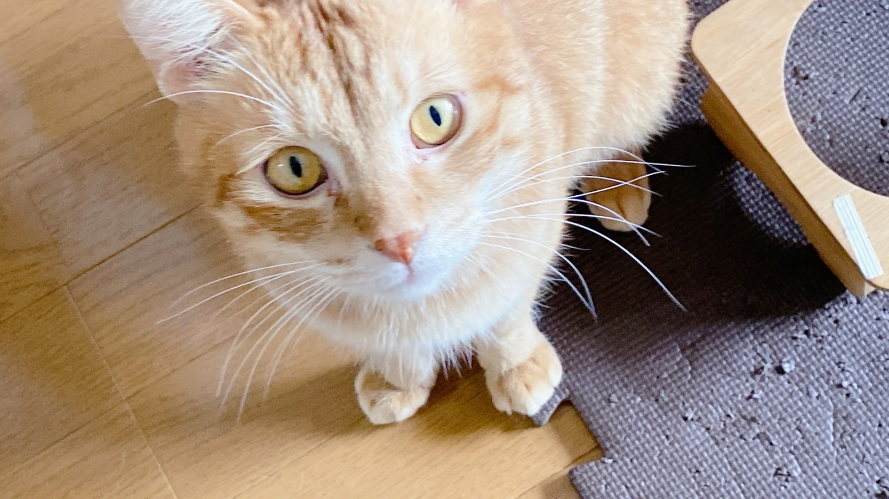
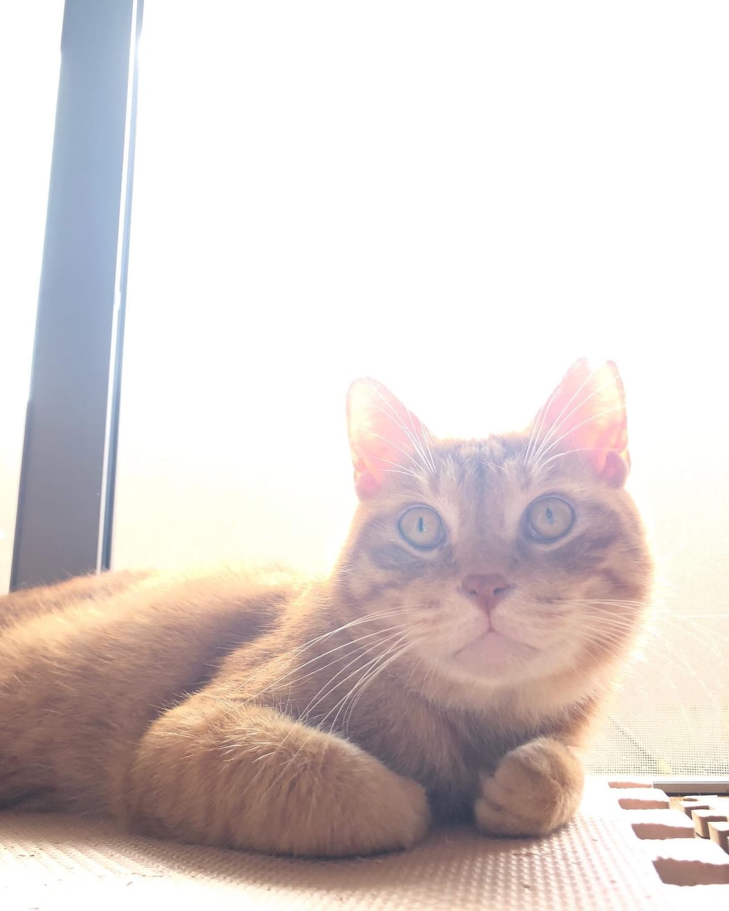

年末年始は、花束や鉢植え、ごちそう、お菓子が一気に家に増える時期です。猫にとって本当に危ないのはどれで、どれは心配しすぎなくていいのか。食べてしまったかもしれないとき、まず何をすればいいのか。獣医学の資料をもとに整理しました。

## ユリは花粉をなめただけでも腎臓を傷める

いちばん気をつけたいのがユリです。米国食品医薬品局（FDA）の解説によると、テッポウユリ（イースターリリー）、アジアティック系やオリエンタル系、スターゲイザー、オニユリ、そしてワスレグサの仲間（デイリリー）は、猫にとって毒性がとても強い植物。花、葉、茎だけでなく、花粉や花瓶の水まで危険で、葉を少しかじった、体についた花粉を毛づくろいでなめた、という程度でも腎臓が傷むことがあるそうです。原因になる成分はまだわかっておらず、腎不全を起こすのは猫だけだと書かれています。

症状の進み方も具体的に示されていました。食べてから12時間ほどは元気がない、よだれ、吐く、食欲がないといった様子。12〜24時間でおしっこが増えて脱水ぎみになり、24〜72時間で腎不全に至ります。治療を始めるのが18時間以上遅れると、腎臓のダメージはたいてい元に戻らないとのこと。

国内にも報告があります。山口県の動物病院の獣医師が2010年に山口獣医学雑誌で報告した症例では、急性腎不全になった3歳のオス猫に腹膜透析まで試みたものの、翌朝に亡くなりました。飼い主があとから、数日前にユリの花と葉を食べていたと伝えたそうです。ユリ中毒を確定できる検査はなく、猫の急性腎不全では飼い主に食べた可能性を確かめることが大切だ、と論文はまとめています。

同じ「リリー」と名前がつく植物でも、カラーやスパティフィラム（ピースリリー）は口の中を刺激する程度で、たいていは自然に治まるとされています。とはいえ見分けに自信がないなら、ユリと名のつく花は猫のいる家に入れない、と決めてしまうほうが早いです。

*ごはん皿の台の横から見上げるムギ。*

## ポインセチアは「置かないほうが無難」くらい

クリスマスの定番ポインセチアは、猫に猛毒だと思われがちな植物です。米パデュー大学の植物診断ラボの記事では、中毒情報センターや大学の評価は「皮膚を刺激する程度」「毒性はかなり低い」が中心で、葉や苞（赤い部分）を大量に食べない限り害はないと説明されています。かじればよだれが出たり、飲みこんで吐いたりすることはあります。白い樹液も口を刺激することがあります。

ユリほど深刻ではない、というのが今の評価。それでも吐けば猫はつらいので、手の届かない場所に置くのが現実的です。環境省のペットフード・ガイドラインでも、シクラメン、クロッカス、アイビー、スズランなどが犬や猫にとって危険の可能性がある植物として挙げられています。年末に鉢植えをいただいたら、置き場所を先に決めておきましょう。

## ネギ類とチョコは「量が少なくても」「種類によって」危ない

ごちそうで気をつけたいのはネギ類です。MSD獣医マニュアルによると、タマネギやニンニクなどのネギ類に対していちばん弱い動物が猫。生のタマネギで体重1kgあたり5g、加熱したタマネギなら小さじ1杯に満たない量で中毒が出た例が報告されています。生でも、加熱しても、乾燥させた粉末でも中毒は起きます。すき焼きの残り汁、ネギ入りの雑煮、オニオンパウダーを使ったお惣菜も、同じように猫の口に入らないようにしておくと安心です。

ネギ類は赤血球を壊して貧血を起こし、症状は数日たってから出てくるのが特徴です。元気や食欲がない、呼吸が速い、白目や歯ぐきが黄色っぽい、おしっこが赤黒い、といった変化が見られます。食べた直後に平気そうでも安心できません。

チョコレートについては、環境省のガイドラインに、猫でも犬ほどではないものの吐く、下痢、けいれんといった症状が出ることがあると書かれています。中毒のもとはテオブロミンとカフェイン。メルク獣医マニュアルの表では、この2つを合わせた量が1gあたりココアパウダーで28.5mg、無糖の製菓用チョコで15.5mg、ミルクチョコで2.3mgと、種類によって10倍以上も違います。症状が出るのは、たいてい食べてから6〜12時間以内。ココアや高カカオのチョコほど、テーブルに置きっぱなしにしないよう気をつけたいところです。

*窓辺でくつろぐテン。窓辺は鉢植えを置きたくなる場所でもあります。*

## 食べたかもしれないとき、家で吐かせない

誤食に気づいたとき、ネットで調べて家で吐かせようとするのはやめてください。米国の動物虐待防止協会（ASPCA）は、猫を家で安全に吐かせる方法はないとしています。犬で使われることがあるオキシドールも、猫には胃や食道への刺激が強すぎるので使ってはいけない、とのこと。塩を飲ませる方法は、かえって中毒を起こす危険があります。

ねこの惑星からの提案として、動物病院に電話する前に、次の3つをメモしておくと話が早く進みます。

- 何を食べたか（植物なら現物か写真。FDAも、ユリかどうかを見分けるために持参をすすめています）
- いつごろ、どのくらいの量か
- 今出ている様子（吐いた、よだれ、元気がないなど）

ユリは治療が遅れると腎臓が元に戻りにくく、ネギ類は症状が数日遅れて出ます。元気そうに見えても様子見はせず、すぐ動物病院に連絡してください。特にユリは、花粉をなめたかもしれない程度でも受診を急ぐべき植物です。夜でも診てもらえる病院は、年末年始の休みに入る前に調べておきましょう。環境省のガイドラインも、かかりつけ医の電話番号を控えておくようすすめています。

## 年末の買い物の前に決めておくこと

ムギは新しいボールやねこじゃらしが来ると夢中になる猫で、テンはカメラにまで顔を寄せてくるほうです。家に新しい物が増える年末は、2匹にとって確かめたい物だらけの季節でもあります。

花束を買うならユリ抜きで頼む。鉢植えは猫の入れない部屋へ。ネギとチョコは食卓に出しっぱなしにしない。そして、年末年始に開いている動物病院の電話番号を冷蔵庫に貼っておく。今日できるのは、この4つです。
