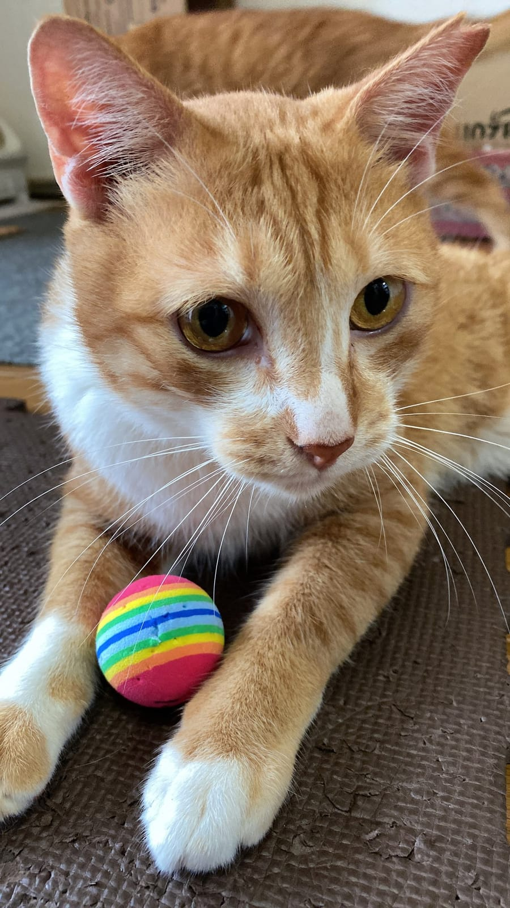
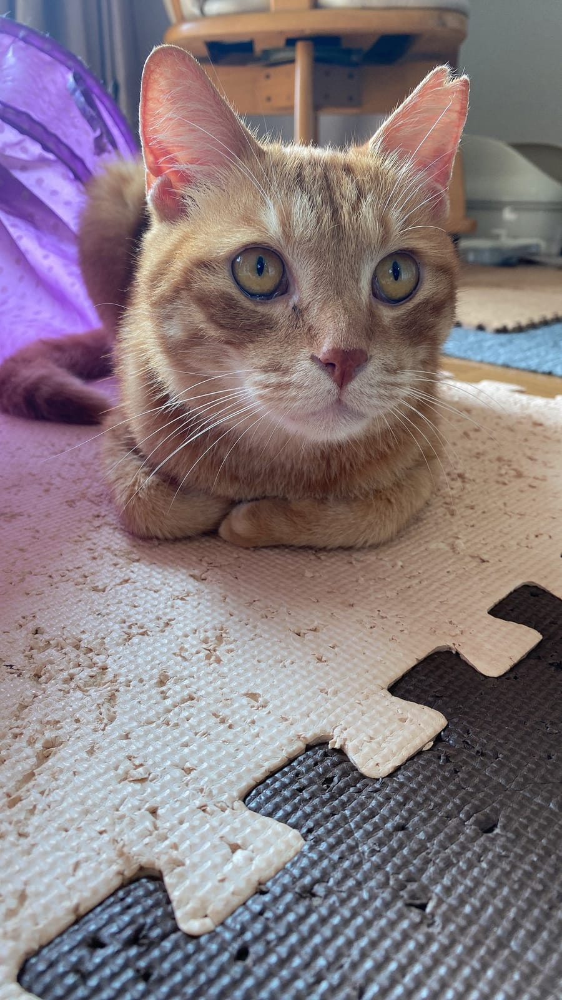

保護猫を迎えたいけれど、お金はどれくらい見ておけばいいのか。ここでは、迎えるときにかかる動物病院の料金、毎月・毎年の支出、そして一生ぶんの合計を、業界団体や獣医師会の調査の数字で確かめます。どの数字も「何年の調査か」を添えておきます。

## 一生でかかるお金は約160万円（2024年調査）

まず全体像から。ペットフード協会の「令和6年（2024年）全国犬猫飼育実態調査」によると、猫1匹の生涯必要経費は160万6,097円でした。同じ調査で、猫の平均寿命は15.92歳。東京都動物愛護相談センターのページでは、この金額は年齢ごとの平均支出を平均余命まで積み上げて出したものだと説明されています。

面白いのは、外に出るかどうかで数字が分かれること。外に出ない猫は生涯必要経費が172万5,072円、平均寿命は16.34歳。外に出る猫は119万4,162円で、14.24歳でした。外に出ない猫のほうが長く生きるぶん、かかるお金の合計も大きくなる、という見方ができます。

ねこの惑星のテンとムギは、2匹とも完全室内飼い。つまり、上の数字でいえば「外に出ない猫」の側です。長く一緒にいられることと、そのぶん費用が続くことは、セットで考えておきたいところ。東京都のページも、犬や猫は15年以上生きると書いています。

## 毎月いくら？フード代と医療費の内訳

次は月単位の話です。同じ2024年の調査では、猫にかける1か月の支出総額は、医療費なども含めて平均1万1,004円。そのうち主食のキャットフードが4,203円、おやつが1,913円でした。

1匹だけ飼っている人に絞ると、支出総額は8,930円。項目ごとの平均は次のとおりです。

- 獣医にかかる医療費は3,494円
- 猫の保険は2,690円
- 猫の雑貨は1,544円
- おもちゃ・衣類は840円

ただし、この内訳は「その項目にお金を使った人だけ」の平均だそう。保険に入っていない人は保険の平均に含まれていないので、足しても総額とは一致しません。

*新しいボールが来ると、ムギは夢中になります。*

おもちゃ代が月840円というのは、意外と控えめな印象かもしれません。ムギは新しいボールやねこじゃらしに夢中になるタイプですが、テンもムギも、箱を見つけると入らずにはいられない2匹でもあります。届いた荷物の段ボールが、いちばん人気の遊び場になる日もあるわけです。

## 年間では約19.5万円、治療費は前年の約1.5倍に

年単位の調査も見てみます。アニコム損害保険が2026年3月に発表した調査では、2025年の1年間に猫1匹にかけた支出は19万5,427円で、前年の109.5%でした。中でもケガや病気の治療費は4万7,130円と、前年の145.2%に増えています。

ペットフード協会の月1万円ほどという数字より高めに見えますが、調査の方法が違います。アニコムの調査は、同社のペット保険の契約者に聞いたインターネットのアンケート。保険に入っている人ばかりなので、保険料や通院の費用が数字に入りやすい、という違いは頭に置いておくとよさそうです。どちらが正しいというより、「月1万円前後から、年20万円近くまで幅がある」と受け止めるのが現実的でしょう。

## 迎えるときの病院代は、ワクチン4,000円・不妊手術1〜2万円台が目安

最後に、迎えた直後にかかりやすい動物病院の料金です。日本獣医師会が全国の動物病院に聞いた調査（令和3年＝2021年に実施、令和5年に公表）では、料金の中央値が次のようになっていました。

- 初診料は1,500円
- 猫の混合ワクチン（猫白血病ウイルスを含まないもの）は4,000円
- オスの去勢手術は1万2,500円
- メスの避妊手術（卵巣と子宮をとる方法）は2万2,500円

中央値なので、病院によって高い所も安い所もあります。調査から5年たっているので、いまの料金は受診先で確かめてください。

ここからは、ねこの惑星からの提案です。保護猫は、譲渡元でワクチンや不妊手術が済んでいるかどうかで、最初の病院代が大きく変わります。迎える前に、譲渡元に「どこまで済んでいるか」「健康診断の記録はあるか」を聞いておくと、最初の病院代の見通しが立てやすくなります。トイレやキャリーケース、爪とぎなどの道具も最初にそろえる必要がありますが、値段の幅が大きいので、高いものから買わず、猫の好みを見ながら買い足すのがおすすめです。

*パズルマットの上で香箱座りのテン。*

## 迎える前に、家計のメモを1枚つくる

数字を並べると身構えてしまいますが、大事なのは「毎月いくら」と「急な出費にいくら」を分けて考えることです。毎月のフード代や砂代は家計に組みこみ、病気やケガのぶんは別に積み立てるか、保険を検討する。ねこの惑星では、迎える前にこの2つをメモ1枚に書き出してみることをすすめています。

迎えたあと、食欲が落ちた、元気がないといった様子が続くときは、費用のことは後回しにして、まず動物病院に相談してください。

次にやることは、近くの動物病院に初診料とワクチン代を聞いてみること。数字がひとつ手元にあるだけで、迎える日の準備がぐっと具体的になります。
