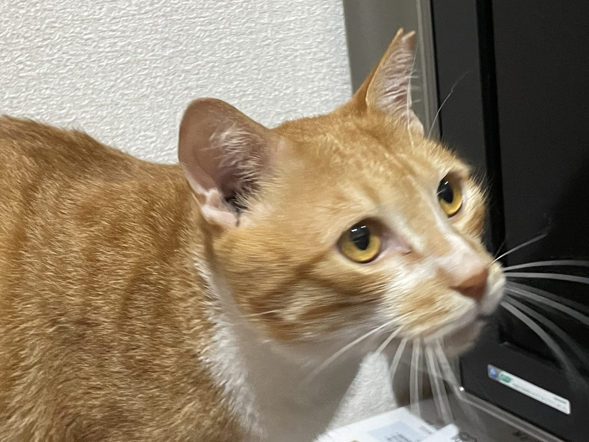
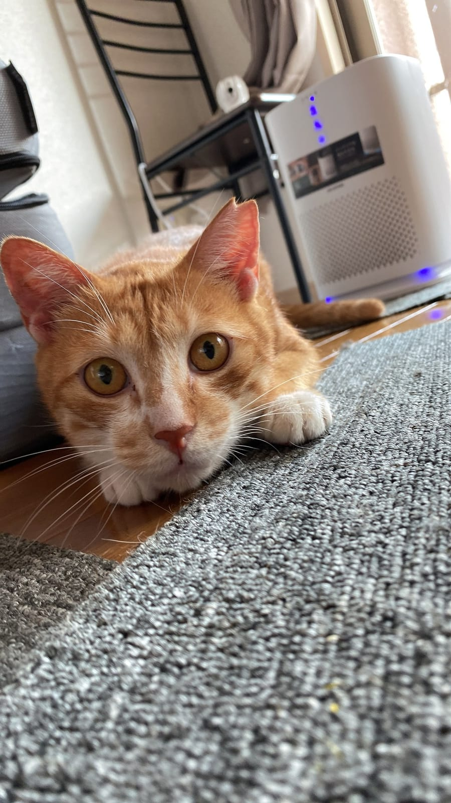

床や服につく抜け毛が増えてきたら、換毛期のサインです。毛玉がどうやってできるのか、ブラッシングは週に何回が目安なのか、そしてブラシを見ると逃げる猫にどう慣れてもらうのか。最後に、吐く回数がどう変わったら動物病院に相談するかも書いておきます。

## 毛玉はどうやってできる？

コーネル大学の猫健康センターによると、猫の舌の表面には、のどの方向に向いた小さなとげ（乳頭）が並んでいます。毛づくろいで抜けた毛は、このとげに運ばれるようにして飲みこまれていくそうです。

毛の主成分はケラチンで、猫のおなかでは消化できません。ほとんどはうんちと一緒に出ていきますが、一部が胃に残って湿ったかたまりになる。これが毛玉です。同センターは、1〜2週間に1回くらい毛玉を吐くのは珍しくなく、たいていは困りごと程度だと説明しています。

ただ、毛玉が大きくなりすぎて胃から腸へ進めなくなると話は別。小腸に詰まるケースはまれでも、手術が必要になることがあるとのこと。長毛種や若くない猫、そして毛が生え変わる季節に毛玉が増えやすいことも書かれていました。

## 換毛期は春と秋、室内猫は一年じゅう少しずつ

アメリカの動物病院グループVCAの解説では、涼しい地域の猫は晩春と晩秋の年2回、たくさん毛が抜ける時期があり、とくに外に出る猫で目立つとされています。下毛がかたまりで抜けることも多いそうです。一方、室内で暮らす猫は、一年を通して少しずつ抜け続けるのがふつう。

テンとムギは2匹とも短毛の茶トラで、完全室内飼いです。なので「秋だけ気をつければいい」とは考えず、ブラシは季節を問わず手の届く場所に置いておく、というのがねこの惑星の考えです。

*オレンジの背中と白い胸。ムギは毛の色の境目がはっきりしています。*

## ブラッシングは週に何回がいい？

目安は毛の長さで変わります。イギリスの猫保護団体Cats Protectionは、短毛の猫なら週1回ほど、春と秋の換毛期には週2回、長毛の猫は毎日としています。コーネル大学の獣医師は、毛玉の予防として毎日のブラッシングと、くしでのお手入れをすすめていました。毎日ブラシをかけると、猫が飲みこむ毛の量が減るため、毛玉も減ることがあるとVCAは書いています。

道具選びも毛の長さが基準です。短毛なら目の細かいくしとやわらかいブラシ、長毛ならそれに目の粗いくしを足す、というのがオーストラリアの動物福祉団体RSPCAの案内。Cats Protectionによると、なでられている感覚に近い手袋タイプのグルーミンググッズを好む猫もいるそうです。ブラシは基本的に毛の流れに沿って動かします。毛がもつれていても引っぱらないこと。痛みにつながるからです。

ブラッシングのついでに、わきの下や内もも、耳のうしろに毛のかたまりがないかも見ておくと、しこりや皮膚の荒れに早く気づけます。

## ブラシを嫌がる猫には「なでてから、ひとなで」

いきなりブラシを当てると、多くの猫は身をよじって逃げます。RSPCAがすすめている慣らし方を、ねこの惑星なりに順番に並べてみました。

- まず手でなでて、猫が触られて喜ぶ場所にだけブラシを2、3回すべらせる
- 落ち着いていられたら、すぐに好物のおやつをあげる
- ブラシの回数、時間、場所を、日をまたいで少しずつ増やしていく
- 押さえつけてまでは続けない

どこから始めるかのヒントになる研究もあります。2015年に発表された猫をなでる実験では、しっぽの付け根をなでたときに、猫の嫌がる反応がいちばん多く見られました。研究者たちは、猫を扱うときはこの部分を避けるよう書いています。慣れるまでは、ほおやあごの下など猫が自分から押しつけてくる場所から始めて、腰からしっぽにかけては最後に回す。これはねこの惑星からの提案です。

やめどきのサインも知っておきたいところ。しっぽを大きく振る、耳を伏せたりぴくぴく動かしたりする、体がこわばる、うなる、シャーと言う、急に自分で激しく毛づくろいを始める。こうした様子が見えたら、その日は終わりにして、時間をおいて出直します。Cats Protectionも、少しずつ積み上げていくことと、押さえつけを最小限にすることをすすめていました。

*ブラシを持つ前に、まずは目線の高さで「いまいい？」の確認から。*

## 吐き方が変わったら動物病院へ

毛玉を吐くこと自体はよくあることですが、パターンが変わったときは要注意です。RSPCAは、毛玉を吐く回数が増えたときや、これまで吐かなかった猫が吐くようになったときは、獣医師に相談するよう案内しています。コーネル大学は、元気がない、1〜2日以上ごはんを食べない、何も出ないのにえずき続ける、くり返し吐く、といった様子があれば受診をすすめていました。せきのような音を何度も立てるのは、毛玉ではなく喘息など別の病気のこともあるそうです。

市販の毛玉対策フードや下剤は、獣医師の判断なしに使わないよう、同センターの獣医師は強く注意しています。毛づくろいの量が急に増えた、毛がぱさついてフケが目立つ、といった変化も、病気のサインになることがあります。

まずは今夜、猫がくつろいでいるときに、手でなでたあとブラシを1回だけ。おやつは手の届くところに用意しておきましょう。テンとムギなら、ブラシより先にブラシが入っていた箱のほうに飛びこみそうですが。
