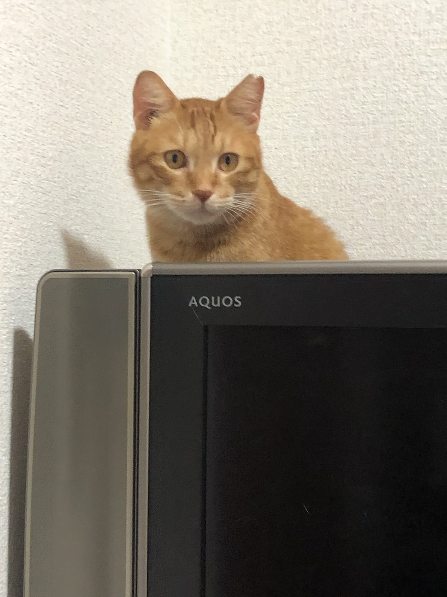

年末年始は、人にとっては楽しい行事が続く時期。けれど猫から見ると、知らない人が来る、家族が何日もいなくなる、ごはんの時間がずれる、と「いつも」が崩れる日の連続です。いつもと違う日々が猫の体にどう響くのか、来客と留守番それぞれに何を用意しておけばいいのか。研究と獣医学会のガイドラインをもとに整理しました。

## 「いつもと違う」だけで、健康な猫も体調をくずす

オハイオ州立大学の研究チームが、健康な猫12匹と、間質性膀胱炎という病気を持つ猫20匹を77週間にわたって観察した研究があります。大学の飼育施設で暮らす猫たちについて、いつもの世話係がしばらく不在になって知らない人が代わりにお世話をする、ごはんの時間が3時間遅れる、といった「ふだんと違う出来事」があった週と、何もない週を比べたもの。

健康な猫に限っても、体調不良のサインはいつも通りの週で平均0.4回、変化があった週では1.9回でした。全体で見ると、ふだんと違う出来事がある週は、体調不良のサインが出るリスクが約3.2倍。多かったのは、吐く、トイレ以外の場所で排せつする、食べる量が減る、の3つだったそうです。

もちろん、研究施設の猫と家庭の猫はまったく同じではありません。それでも、世話係の不在や食事時間のずれといった変化が並んでいるのを見ると、年末年始の家の中とよく似ています。病気がない猫でも「変化そのもの」で体調をくずしうる、という点は覚えておきたいところです。

## 来客の日は「見えないところに逃げられる」部屋づくりを

米国猫医療協会と国際猫医学会が出した猫の住環境のガイドラインでは、猫の暮らしを支える柱の1本目に「安全な場所」を挙げています。猫は、危険かもしれない相手が視界から消えれば、体がすっかり隠れていなくても落ち着きやすいとのこと。例として挙がっているのは、横倒しにした段ボール箱や、なじんだにおいのするキャリーです。隠れるのは、猫がストレスに対処するときにとる行動だとも書かれていました。

環境省のパンフレットも、高い所や狭い所に安心できる隠れ場所をつくること、キャリーバッグを隠れ場所として使うことをすすめています。

隠れ場所の効果を確かめた研究もあります。オランダのユトレヒト大学が、保護施設に来たばかりの猫19匹を、隠れ箱がある組とない組に分けて観察したもの。箱がある組は3〜4日目のストレスの点数がはっきり低く、14日目には両方の組が同じ水準に落ち着きました。箱があると、新しい環境に早く慣れたというわけです。

来客の日に、ねこの惑星がすすめたい準備は次の3つです。

- お客さんが入らない部屋を1つ決め、箱やキャリー、水、トイレを置いておく
- 箱やキャリーは前日までに出して、猫のにおいになじませておく
- 部屋には猫が自分で出入りできるようにして、閉じこめない

*高い所も、猫にとっては立派な避難場所。*

お客さんにも、ひとこと伝えておくと安心です。イギリスの猫の保護団体Cats Protectionは、猫を取り囲まないよう来客にお願いすることをすすめています。ガイドラインでも、猫に近づくときは目線を低くし、じっと見つめず、触れるかどうかは猫に決めさせる姿勢が紹介されていました。隠れている猫を引っぱり出さない、というのもその延長です。

## 留守番は「誰が、何回来るか」で考える

帰省で家を空けるときは、猫をペットホテルに預けるか、家に来てもらうかを考えることになります。熊本市動物愛護センターのページでは、自宅に来てお世話をしてくれるペットシッターについて、環境の変化によるペットのストレスを減らしたいときに役立つと紹介しています。先ほどのガイドラインにも、猫はなじんだ縄張りを好み、そこを離れざるをえないときは避けたり隠れたりして反応する、とありました。

家に来てもらう場合、Cats Protectionは少なくとも1日2回は様子を見てもらうよう呼びかけています。フードやトイレの砂、薬は留守のあいだ足りる量を用意し、かかりつけの動物病院と緊急連絡先を書いたメモを残しておくこと。ここに、ねこの惑星からの提案をもう1つ足すなら、ごはんの時間とトイレ掃除の手順をメモにして、いつもの順番をなるべく変えないでもらうことです。

においの面も見落としがちなポイント。ガイドラインでは、洗剤や香りつきの猫砂など、いつもの環境のにおいを変えてしまうものは避けるよう書かれています。寝床の布も全部いっぺんに洗わず、順番に洗って猫のにおいが残るものを手元に置いておく、というすすめ方でした。大掃除の時期でも、猫の毛布は一部を洗わずに残しておくのがおすすめです。

## 帰ってきたら、まず「いつも」を取り戻す

Cats Protectionは、ストレスのサインとして、引きこもる、食べる量や飲む量が減る、うろうろ歩き回る、トイレ以外で排せつする、毛づくろいをしすぎる、といった様子を挙げています。帰省から戻った日や来客が帰った夜は、ごはんの量とトイレの様子をいつもより気にかけてみてください。吐く回数が増えた、食べない日が続く、といった変化があれば、早めに動物病院に相談を。トイレに何度も行くのにおしっこがほとんど出ない、いきんでいる、という様子は急ぎのサインです。コーネル大学猫健康センターは、尿道が詰まった状態を一刻を争う緊急事態としていて、特にオス猫に多いとのこと。この場合は様子を見ずに、夜間でもすぐ動物病院へ連絡してください。

ねこの惑星のテンとムギは、箱を見つけると入らずにはいられない2匹で、2匹そろって箱に収まっていたこともあります。大掃除で出た段ボールを、すぐに捨てずに1つ残しておく。来客の日の避難場所づくりは、それだけでも一歩目になります。
