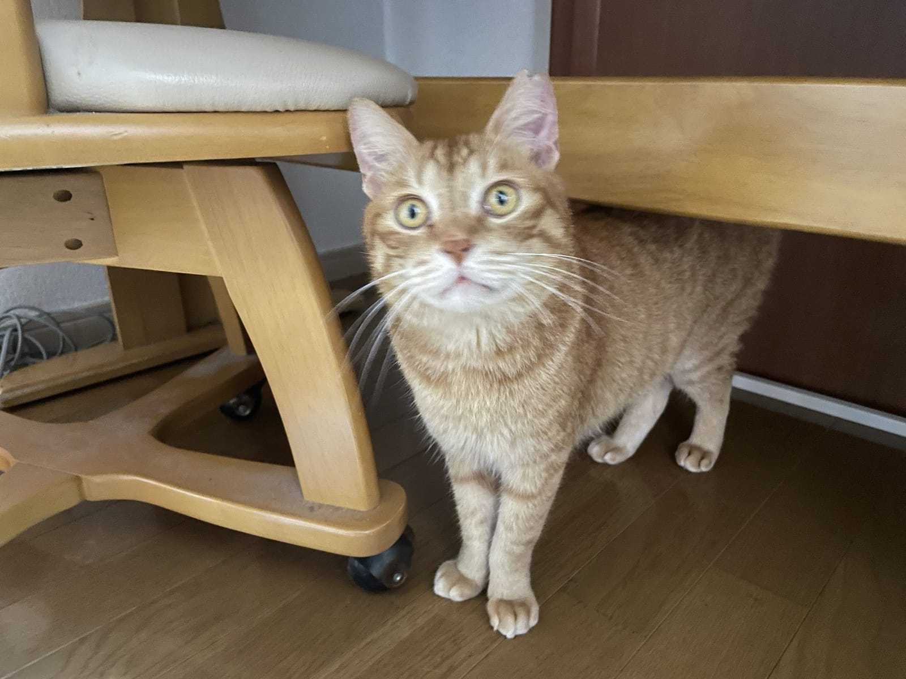
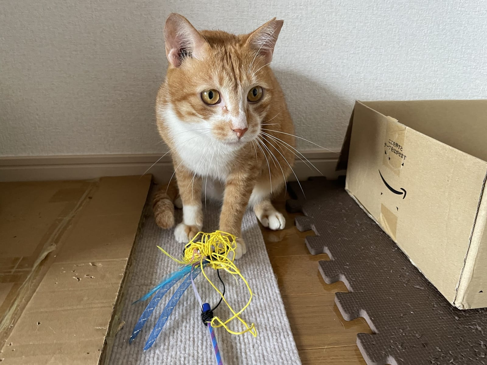

北九州市で保護された猫は、どこへ行き、何頭が新しい家族のもとへ渡っているのか。市の動物愛護センターが公表している統計を、令和7年度（2025年4月から2026年3月）の数字まで読んでみました。センターの役割と、私たち市民が関われる制度もあわせて整理します。

## 小倉北区西港町にある「レインボーポート」

北九州市動物愛護センターは、小倉北区西港町24番地7にあります。いまの建物ができたのは1993年1月。2015年には「レインボーポート」という愛称も決まりました。

施設紹介のページを見ると、動物棟には成犬室や治療室と並んで「ねこ室」があり、収容できる数は犬110頭、猫133頭とされています。沿革によれば、市が飼えなくなった猫の引取りを始めたのは1974年。犬・猫の譲渡が始まったのは1978年のことでした。2016年には猫の譲渡用飼育室、翌2017年には猫の保護観察室が増設されていて、猫を受け入れて次の家へつなぐための場所が少しずつ広げられてきたことがわかります。

猫に関するセンターの仕事は、大きく分けると次の4つです。

- 飼い主がやむを得ない事情で飼えなくなった猫や、自力で生きられない所有者不明の子猫の引取り
- 飼い主のわからないけがや病気の猫の保護と、応急的な手当て
- 新しい飼い主への譲渡と、毎月第2土曜日の譲渡会（予約制、飼い方の講習つき）
- 飼い方の苦情への調査・指導と、地域猫活動などの支援

ちなみに、飼えなくなった猫を引き取ってもらうには手数料がかかります。条例で定められた額は1頭2,000円、生後91日未満なら400円です。

## 猫の引取りは、令和7年度に110頭まで減った

市の「統計資料」には、平成28年度からの猫の数字が年度ごとに並んでいます。いちばん目を引くのは引取り頭数の変化でした。

平成30年度の562頭をピークに、令和2年度は363頭、令和6年度は207頭。そして令和7年度は110頭まで下がっています。けがや病気で保護された猫も、平成30年度の233頭から令和7年度は78頭へ。猫についての苦情の受付件数も、令和5年度の458件から令和7年度は280件に減りました。

全国はどうか。環境省の集計では、令和6年度に全国の自治体が引き取った猫は2万2,010頭。そのうち1万1,062頭は、飼い主のわからない幼い猫でした。子猫が多いという事情は、北九州市の引取りの説明に「自活できない子猫」が挙がっていることとも重なります。

## 譲渡と致死処分の数字から見えること

一方で、譲渡の数は令和に入ってから減る傾向にあります。令和2年度は241頭、令和6年度は140頭。令和7年度は53頭でした。引取りそのものが減っているので、送り出す猫の数が減るのは自然な流れとも読めます。ただ、統計資料には増減の理由までは書かれていません。気になる方は、センターに直接たずねてみるのが確実です。

致死処分は、平成28年度の25頭に対して、令和6年度は6頭、令和7年度は12頭でした。市は2014年11月に「犬猫致死処分ゼロ社会宣言」を出しています。オープンデーの案内では、令和6年度に致死処分した犬猫は、病気やけがで回復の見込みがない7頭まで減ったと説明されていました。宣言のいう「ゼロ」は、治る見込みのない犬猫を除いた数え方だということになります。

参考までに、環境省の集計では令和6年度に全国で殺処分された猫は4,866頭、譲渡された猫は1万6,854頭でした。

*カメラがあると、顔を近づけてくるのがテン。*

## 市民が関われる3つの入り口

センターの仕事には、市民が手を貸せるしくみもあります。市の制度で、いま参加できるものを挙げておきます。

ひとつ目は、幼い子犬・子猫を自宅で育てる一時預かりボランティア。いわゆるミルクボランティアで、20歳以上70歳未満の市内か近郊に住む人が対象。募集は10名から15名ほどで、随時受け付けています。

ふたつ目は地域猫活動の支援。2026年7月から制度が見直され、地域住民を含む2名以上で団体をつくれるようになりました。センターで受けられる無料の不妊去勢手術の枠も、メス3匹かオス5匹に広がっています。手術を受けた猫は、耳先をV字にカットして見分けるそうです。

みっつ目は、保護した猫を譲渡する団体や個人向けの不妊去勢手術の補助。令和8年度はメスで1万1,000円、オスで5,500円が補助されます。

## まずは譲渡会のページをのぞいてみる

ねこの惑星のテンとムギは、2匹とも茶トラのオスの兄弟です。箱を見つけると、入らずにはいられないのがこの2匹。猫と暮らすと、こうした「その子だけのくせ」が毎日の楽しみになります。

*箱があれば入る。ムギの基本方針です。*

猫を迎えたいと考えている方へ、ねこの惑星からの提案です。いきなり決めなくてかまわないので、まずは市のホームページで譲渡会の日程と、譲渡を待っている猫の情報を見てみてください。迎える準備がまだという方は、預かりボランティアや、フードの寄付という関わり方もあります。センターの電話番号は093-581-1800です。
