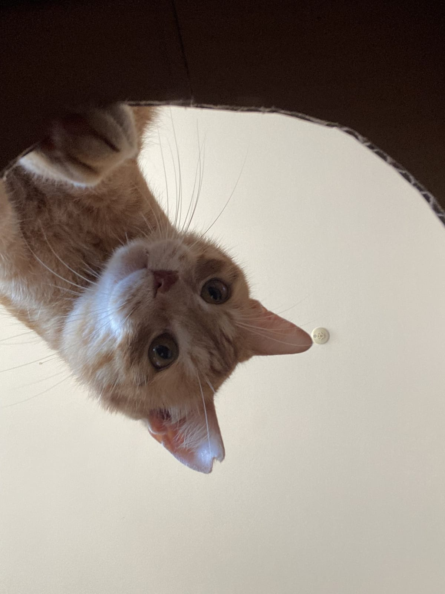
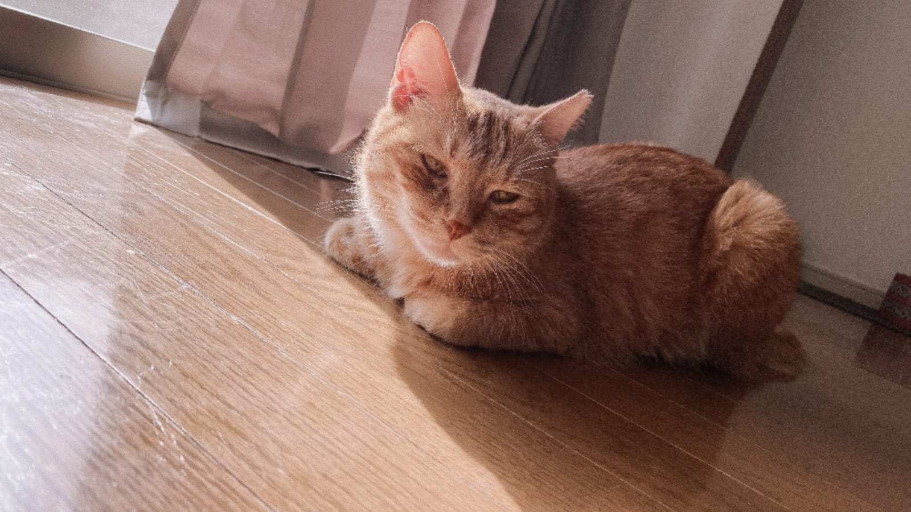

北九州も朝晩がぐっと冷えてきました。エアコンを20℃前後にして「これで十分」と思っている部屋が、猫にとってはまだ寒いかもしれない、という話から始めます。猫の体が求める温度、こたつやホットカーペットとの付き合い方、そして冬に増えるおしっこのトラブル。この3つを順番に見直していきます。

## 猫が「何もしなくても快適」なのは30〜38℃

動物には、体温を保つために余計なエネルギーを使わなくてすむ気温の幅があります。熱中性帯（TNZ）と呼ばれるもので、アイルランドの獣医師向け専門誌によると、猫の熱中性帯は30〜38℃。人が快適に感じる18〜25℃よりずっと高い位置にあります。

つまり、人が「ちょうどいい」と感じている20℃の部屋でも、猫の体はひそかに熱を作り続けている状態です。同じ記事では、猫にとっての人間の部屋は、人が8℃の室内にいるような感覚に近いのでは、とまで書かれていました。

だからといって、部屋全体を30℃にする必要はありません。記事の筆者がすすめているのは、猫が自分で出入りできる「暖かい場所」をつくること。部屋はふつうの温度にしておいて、温めたベッドや日なたなど、猫が選べる暖かいスポットを用意しておく考え方です。

ねこの惑星のテンとムギは、箱を見つけると入らずにはいられない2匹です。狭い箱にぴったり収まっている姿を見ていると、暖かさを逃がさない場所を選んでいるのかも、と考えたくなります。理由は猫に聞いてみないとわかりませんが。

*箱の中から失礼します、のムギ。*

## こたつとホットカーペットは「逃げ道」をつくって使う

暖かい場所をつくるとき、いちばん身近なのがこたつとホットカーペットでしょう。どちらも使って大丈夫です。ただ、使い方にひと工夫が要ります。

獣医師への取材記事によると、こたつは温度を最弱にし、布団を少しめくって風の通り道をつくっておけば、使ってかまわないそうです。猫は暑くなれば自分で位置を変えるので、気持ちよさそうに寝ているなら、無理に引っぱり出さなくていいそうです。

気をつけたいのは低温やけど。人の皮膚科の資料では、40〜50℃ほどの「気持ちいい温度」のものに長く触れ続けると、本人が気づかないまま皮膚の奥まで傷むことがあると説明されています。毛に覆われた猫は、皮膚の赤みに飼い主が気づきにくいもの。そこでねこの惑星からの提案です。ホットカーペットは低めの設定にして、上に毛布を1枚かける。カーペットの外にも寝られる場所を残しておく。この2つで、猫が自分で温度を選べるようになります。

*日だまりも立派な暖房。テンはよく知っています。*

## 冬はおしっこのトラブルが増える季節

獣医師が監修するペトコトの記事では、寒くなって水を飲む量が減ると、尿が濃くなって結晶ができやすくなると説明されています。福岡市獣医師会の資料でも、飲む水が少ないと尿が膀胱に長くたまって濃くなり、尿路結石ができやすくなります。

とくに注意したいのがオス猫。オスはメスより尿道が細くて長く、結石が詰まりやすいとされています。詰まると、おしっこが出ない、食欲が落ちる、吐くといった症状が出て、放っておくと急性腎不全につながることもあるそうです。テンとムギも2匹ともオス。他人事ではありません。

トイレの場所も見直しポイントです。先ほどの取材記事では、猫がいる部屋が暖かくても、トイレが寒い場所や離れた場所にあると、行くのを我慢してしまうことがあると指摘されていました。冬のあいだだけでも、猫がよくいる部屋の近くにトイレを1つ増やすと安心です。

## 水を飲んでもらうための小さな工夫

水を飲む量を増やす方法として、ペットフードメーカーの研究機関Purina Instituteの資料では、ウェットフードに切り替える、ドライフードに水を加える、といった方法が挙げられています。鶏の風味をつけた経口補水液で、飲む量が増えたという研究も紹介されていました。

家でできることを並べると、次のようになります。

- 水飲み場を1か所ではなく、猫がよくいる部屋ごとに置く
- 水はこまめに取り替えて、器も清潔にしておく
- ドライフードのときは、水を少し足してみる

ムギは梅雨の時期も、こまめに水を飲みに行っていました。季節を問わず水をよく飲む猫もいれば、冬になるとぱったり飲まなくなる猫もいます。いつもの飲みっぷりを知っておくと、変化に気づけます。

## 今日からできる冬じたく

まずは猫がよくいる場所を見回して、毛布1枚ぶんの「暖かい逃げ場所」があるか確かめてみてください。次にトイレまでの道のりが寒くないか。最後に、水飲み場の数。

トイレに何度も行くのに少ししか出ない、おしっこが出にくそうにしている、といった様子があれば、早めに動物病院へ。おしっこがまったく出ていないときは命に関わることもあるので、すぐに受診してください。

テンとムギが入る箱にも、そろそろ毛布を1枚敷いてあげようと思います。
