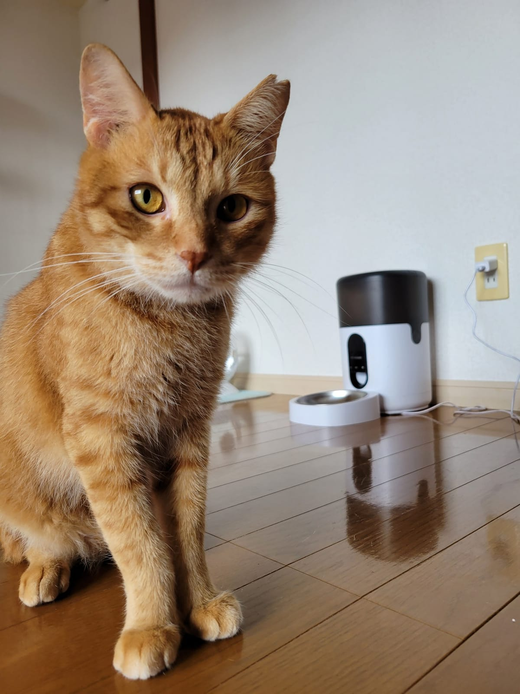

猫をなでていると聞こえてくる、あのゴロゴロ。じつは「どうやって鳴らしているのか」も「なぜ鳴らすのか」も、まだ研究が続いている音です。のどの中で何が起きているのか、2023年に発表された新しい実験の結果、そして「うれしい」だけでは説明できないゴロゴロの場面。この3つを順に読み解きます。

## 音の出どころは、のどの奥にある「喉頭」

ゴロゴロの音源として、いちばん有力とされているのが喉頭（こうとう）です。人でいえば声帯があるあたり。米国議会図書館の科学解説によると、喉頭の内側にある筋肉が声門をすばやく開け閉めすることで、あの振動が生まれると考えられています。その筋肉に「動け」という合図を送っているのが、脳の中にある神経のリズム発生器。ウィーン大学の発表によれば、こうした「脳の合図で筋肉が縮んだりゆるんだりして鳴る」という説明が、およそ50年にわたって主流だったそうです。

裏づけのひとつが、喉頭の筋肉がまひした猫はゴロゴロを鳴らさないという観察です。かつては、太い静脈（大静脈）を流れる血液の音だという説もありましたが、その後の研究で、喉頭の筋肉のほうに目が向くようになりました。

もうひとつおもしろいのが、息の向き。ニャーという鳴き声は吐く息でしか出ませんが、ゴロゴロは吸うときも吐くときも続きます。2003年当時カリフォルニア大学デービス校獣医学部の助教授だったLeslie A. Lyons氏も、喉頭と横隔膜の筋肉に断続的に合図が送られることでゴロゴロが生まれ、息を吸っても吐いても鳴り続ける、と解説しています。

## 2023年の実験で、筋肉の合図がなくても鳴ることがわかった

この「脳が筋肉を細かく動かして鳴らす」という説明に、2023年、ウィーン大学の音声科学者クリスティアン・ヘルブスト氏らのチームが新しい見方を加えました。研究はCurrent Biology誌に掲載されています。

チームが使ったのは、8匹の猫から取り出した喉頭。脳からのリズムの合図も筋肉のくり返しの収縮もない状態で、8つすべてがゴロゴロと同じ高さで振動しつづけました。音の出方は、人が声をかすらせて低く出す「ボーカルフライ（エッジボイス）」によく似ているそうです。

ゴロゴロの高さは20〜30ヘルツほど。人の声で出せるいちばん低い音よりも、まだ低い音域です。体重数キロの小さな動物が、なぜこんなに低い音を出せるのか。チームは解剖学的な調べで、猫の声帯の中に独特の「パッド」のような部分があることを見つけ、これが低い音の理由になっている可能性を挙げています。

ただし、研究チーム自身も、昔の説が完全に否定されたわけではないとしています。わかったのは「これまでの理解では足りなかった」ということ。ゴロゴロのしくみは、まだ書きかけの教科書のページなのです。

## ごはんの催促に混ざる、赤ちゃんの泣き声のような音

では、猫はなぜゴロゴロを鳴らすのか。よく知られているのは、なでられて満足しているとき。もうひとつは子猫と母猫のあいだです。米国議会図書館の解説では、子猫は生まれて数日でゴロゴロを鳴らしはじめ、「元気だよ」「ここにいるよ」と母猫に伝え、きずなを深める役目があると獣医師は考えている、と紹介されています。

ゴロゴロには「おねだり用」もあるようです。2009年、イギリスのサセックス大学のカレン・マッコーム氏らは、おなかをすかせた猫のゴロゴロを分析しました。ごはんを催促するときのゴロゴロには、ふだんの低い音の中に、約380ヘルツの高い鳴き声のような成分が混ざっていたそうです。この高さは、人の赤ちゃんの泣き声とよく似ているといいます。10匹の猫を録音し、50人に聞いてもらったところ、この「催促のゴロゴロ」は、くつろいでいるときのゴロゴロより「急ぎ」で「心地よくない」と評価されました。高い成分を取り除くと、聞き分けられなくなったとのこと。飼い主のほうが少し正確だったものの、猫を飼ったことがない人でも「急いでいる」と感じ取れたそうですから、なかなかの作戦です。

*給餌器の前のテン。ごはん前の音にも耳をすませてみたくなります。*

## 痛いとき、不安なときにも鳴らす

ゴロゴロが「うれしい」の合図とは限らない理由が、もうひとつあります。Lyons氏によると、猫は動物病院に連れて行かれたときや、けがから回復している途中など、ストレスのかかる場面でもよくゴロゴロを鳴らすそうです。米国議会図書館の解説も、けがをしたときや痛みがあるときに鳴らすことがあると書いています。

ゴロゴロの低い振動が骨や傷の回復を助けているのでは、という仮説もあります。Lyons氏の解説では、ゴロゴロの音域は25〜150ヘルツで、この範囲の音が骨密度の改善や治癒の促進につながるという研究者の報告が紹介されています。米国議会図書館の解説も、ゴロゴロが自然の治癒のしくみかもしれないという研究者の説を紹介していますが、どちらも「可能性」として触れている段階。おもしろい仮説として受けとめておくくらいがちょうどいい話です。

ここからは、ねこの惑星からの提案です。ゴロゴロを聞いたら、音だけでなく、そのときの様子もあわせて見てください。

- ごはんを食べているか、いつもどおり水を飲んでいるか
- トイレの回数や、おしっこ・うんちの様子に変わりはないか
- じっと丸まったまま動かない、触られるのをいやがる、といった様子はないか

ゴロゴロ言っているから大丈夫、とは言い切れません。食欲が落ちている、元気がないなど、いつもと違うところがあれば、早めに動物病院で相談してください。なかでも、口を開けて苦しそうに息をしている、トイレで何度もいきむのにおしっこがほとんど出ていない、といった様子は急ぎのサイン。コーネル大学獣医学部も、どちらもすぐに獣医師に診てもらうべき状態だとしています。ゴロゴロ鳴いていても様子見はせず、すぐ動物病院へ連絡してください。

## ムギとテンのゴロゴロも、場面ごとに聞いてみる

ムギは、ソファの上で長く伸びてくつろぐのが好きな猫。テンは、カメラを向けると顔をぐっと近づけてきます。くつろいでいるときのゴロゴロと、ごはんを待つときのゴロゴロ。マッコーム氏らの研究どおりなら、2匹のゴロゴロにも、場面によってちがう音が混ざっているのかもしれません。

なでているときと、ごはん前。おうちの猫で聞き比べるなら、スマートフォンで場面ごとに録音してみてください。録音した日時と、そのとき何をしていたかを一言メモしておくと、あとで並べて聞くときにぐっと楽になります。
