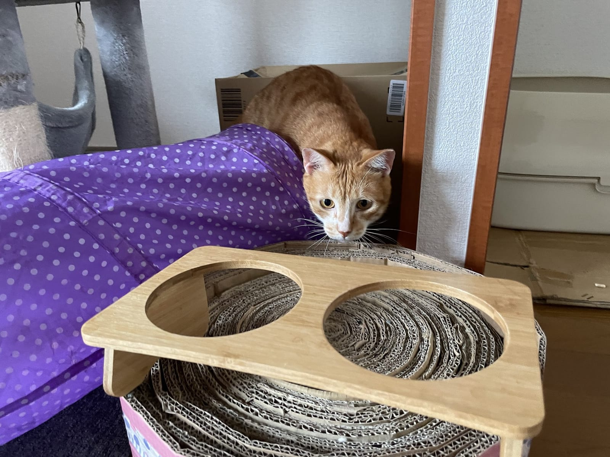

通販の段ボールを床に置いた瞬間、もう猫が入っている。そんな経験のある人は多いはずです。猫が箱に入りたがる理由は、実はまだはっきりとは解明されていません。それでも、ここ10年ほどの研究で「箱があると猫は落ち着くのが早い」ことや「四角く囲まれて見えるだけでも座りたがる」ことがわかってきました。3つの研究と環境省の資料から、その中身と、家での箱の置き方を考えます。

## 床に描いた四角にも、猫は座る

インターネットには「If I fits, I sits（入れるなら座る）」という言い回しがあります。猫がどんなに小さな箱や、床に貼ったテープの四角にまで収まろうとする様子を表した言葉です。これを本気で確かめたのが、2021年に動物行動学の学術誌に載った研究でした。

実験はコロナ禍の2020年6月から8月、飼い主に協力してもらう「市民科学」の形で行われています。飼い主は毎日、図形を2つ床に置き、猫の様子を最大5分間撮影しました。図形は3種類。ふつうの四角い枠と、パックマンのような欠けた円を4つ並べて「四角があるように見える」錯覚図形（カニッツァの四角形）、そして同じ欠けた円を外向きに置いた、四角に見えない図形です。

最後の6回の試行までやり遂げたのは30組。そのうち9匹が図形の中に座り、選ばれた回数は合計16回でした。内訳は、本物の四角が8回、錯覚の四角が7回、四角に見えない図形は1回だけ。猫は輪郭が実際には描かれていない「見えるだけの四角」にも、本物と同じくらい入っていったことになります。

ただし、研究チーム自身が書いているとおり、最後まで残った猫の数は少なく、実験室での確認が必要な段階です。論文の中でも、猫がこうした場所を好む理由はまだわかっていない、とはっきり書かれていました。

## 保護施設では、箱のある猫ほど早く落ち着いた

理由はわからなくても、箱が猫の役に立っていることを示す研究はあります。舞台はオランダの保護施設です。

ユトレヒト大学のチームが2014年に発表した研究では、施設に来たばかりの猫19匹を、隠れられる箱を置く10匹と置かない9匹に分けました。そして14日間、猫のストレスの度合いを行動から点数にする方法（キャット・ストレス・スコア）で観察しています。結果、3日目と4日目には、箱のある猫たちのほうがはっきりと点数が低くなっていました。14日目には両方の点数がそろいましたが、箱のある猫たちはその水準に3日目ごろには到達していたそうです。

2019年には同じ研究者を含むチームが、23匹で条件をより厳密にした比較試験を行っています。箱のある猫は2日目に落ち着いた状態に達し、箱のない猫は9日目。差はちょうど7日間でした。研究チームは、箱は猫が自分でストレスを調整する手助けになる、とまとめています。一方で、来たばかりの猫の体重が減るのは箱があっても防げず、譲渡されるまでの日数にも違いは出ませんでした。箱さえあれば何もかも解決、というわけではないようです。

この論文には、ストレスを感じた猫がトイレの陰で身構えたまま休んでいることがある、という観察も書かれています。身を隠せる場所がないと、猫はそれに近い場所を自分で探す。箱は、その「隠れたい」に正面から応えてくれる道具なのだと思います。

*箱のそばで、じっとこちらを見るムギ。*

## テンとムギも、箱を見つけたら素通りできない

ねこの惑星のテンとムギも、箱を見つけると入らずにはいられない2匹です。今年の3月には、2匹そろってひとつの箱に収まっていました。表紙の写真は、箱の中であおむけになったムギ。さかさまの顔のまま、上からぶら下がるおもちゃに前足を伸ばしていました。

施設に来たばかりの猫ではないので、2匹が箱に入るのはストレスのせいだ、とは言えません。研究でわかっているのは「箱があると落ち着くのが早い」ということまで。とはいえ、安心できる場所を自分で選べる環境は、慣れた家の猫にとっても悪いことではないはずです。

## 家に置くなら、こんな箱を

環境省のガイドラインでは、猫は狭いところが好きなので、体がすっぽり入るハウスや段ボール箱にタオルなどを敷いて寝床にするとよい、と紹介されています。同じ資料には、キャリーケースを普段から寝床として使っておくと、動物病院へ連れて行くときのストレスを減らせるとも書かれていました。

ここからは、ねこの惑星からの提案です。

- 体がちょうど収まる大きさの箱を、人の通り道から少し外れた場所に置く
- 引っ越しや来客、新しい猫を迎えたときなど、環境が変わるタイミングには箱を1つ増やす
- キャリーは押し入れにしまわず、ふたを外して箱代わりに部屋に出しておく

新しく保護猫を迎える人は、とくに最初の数日に意識してみてください。オランダの研究で差がはっきり出たのも、施設に来て間もない時期でした。

隠れてばかりで食べない日が続く、トイレに行かない、といった様子があれば、箱の問題ではなく体調のサインかもしれません。そのときは早めに動物病院に相談を。

まずは今日届いた段ボールを、すぐにつぶさず床に置いてみる。テンとムギなら、きっと迷わず入ります。
