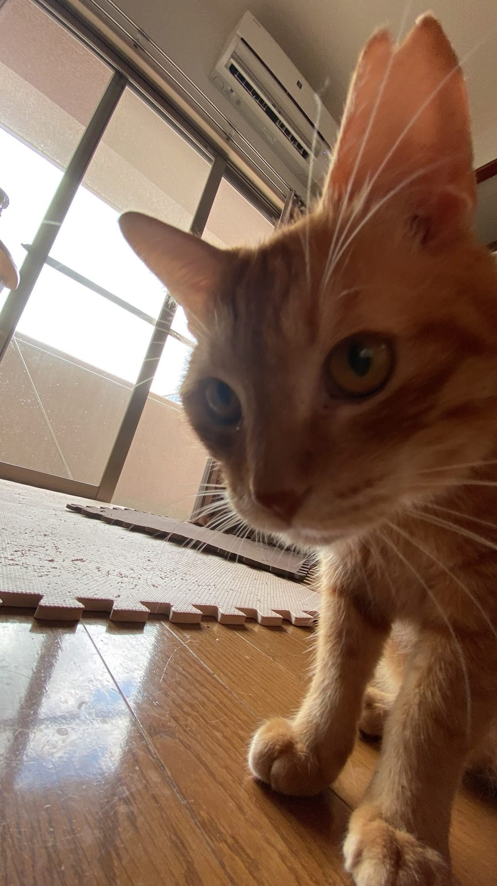
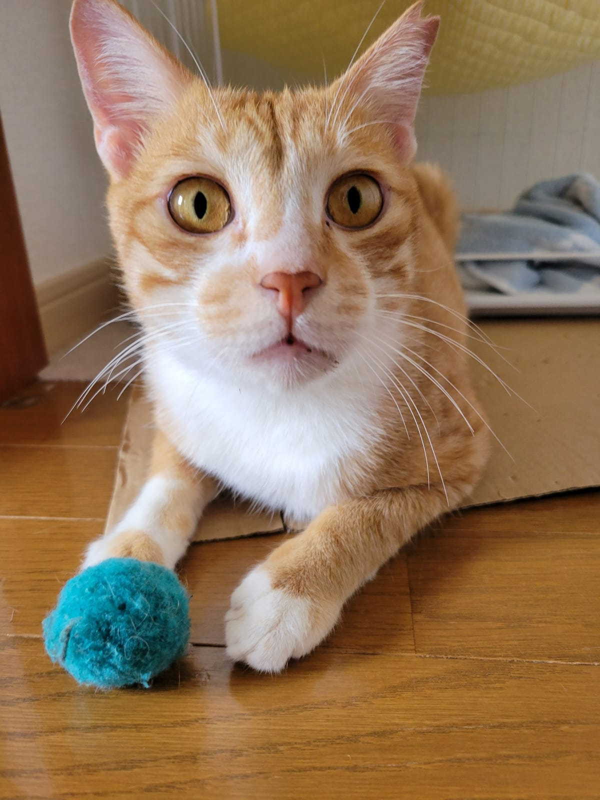

お客さんが来るとソファの下にもぐるのに、しばらくすると少し離れたところからじっと様子を見ている。そんな猫は、ただ「人が嫌い」なのではないかもしれません。京都大学の研究者らが、猫の人見知りを「怖さ」と「近づきたさ」の2つに分けて調べた論文を、11月4日に学術誌『PLOS One』で発表しました。どう調べたのか、猫は何タイプに分かれたのか、そしてどこまで言えるのか。順に読んでいきます。

## 人間の赤ちゃんの「人見知り」と何が同じ？

人の赤ちゃんの人見知りには、単純な「怖い」だけではない形があるそうです。知らない大人に近づきたい気持ちはある。でも怖い。その2つが混ざり合った状態です。

一方、動物の性格研究では「怖がり」から「大胆」までを1本のものさしで測ることが多く、人見知りと怖がりを分けて考えることはあまりありませんでした。研究チームが知りたかったのは、猫にも赤ちゃんのような「怖いけど近づきたい」人見知りがあるのか、という点です。

## どうやって調べた？ 赤ちゃん用の質問票を猫向けに

調べ方は、飼い主へのオンラインアンケートでした。猫に直接テストをしたわけではありません。使ったのは、人の乳幼児の気質を測る質問票を猫向けに作り直したもの。猫1匹ごとに「人見知り」「怖がり」「近づきたさ」の3つを点数にしています。

質問の中身は、たとえば「知らない人に慣れるまで時間がかかる」。近づきたさのほうは、新しいおもちゃに興奮するか、なじみのある親戚や友人が来ても気にしないか、といった項目です。怖がりのほうには、大きな音に驚くか、初めての場所で不安そうにするか、が含まれていました。

アンケートは3回に分けて行われ、合わせて310匹。回答したのはSNSで募集した20〜50歳の女性の飼い主で、猫の年齢は1〜7歳です。2回目は去勢済みのオス114匹、3回目は野良生まれのオス114匹にしぼっています。

## 猫は4タイプに分かれた。いちばん多かったのは？

まず全体の結果から。人見知りの点数と怖がりの点数は、強く連動していました。人見知りが強い猫ほど、怖がりでもある。猫の人見知りは、おもに「怖さ」と結びついているというのが論文の中心の結論です。研究チームが最初に立てた「人見知りと近づきたさの間に、赤ちゃんのような特別な関係が出るはず」という予想は、データでは確かめられませんでした。

ただ、点数の組み合わせで猫をグループ分けすると、別の姿が見えてきます。去勢済みのオス114匹（2回目の調査）は、次の4タイプに分かれました。

- とても社交的（怖がらず、よく近づく）　18.4％
- 社交的（怖がらず、ほどほどに近づく）　28.9％
- 赤ちゃんのような人見知り（怖がりなのに、近づきたさも高い）　42.1％
- 怖がり（怖がって、あまり近づかない）　10.5％

このグループでいちばん多かったのが、「怖いけど近づきたい」タイプです。

野良生まれのオス114匹（3回目の調査）でも、同じような4つのタイプが出ました。こちらは「社交的」が36.0％でいちばん多く、「赤ちゃんのような人見知り」は30.7％、「怖がり」は20.2％、「とても社交的」は13.2％。研究チームは、野良生まれのオスにこのタイプが多いと予想していましたが、結果は逆で、「社交的」タイプより少なくなりました。それでも、グループ分けをした2つの調査のどちらでも、一定の割合の猫が「怖いのに近づく」組み合わせを持っていたことになります。

## まだ言えないことは？ 飼い主の目から見た答えだけ

この研究には、論文自身が挙げている限界がいくつもあります。

いちばん大きいのは、データがすべて飼い主の回答だという点。猫が本当に「近づきたい」と感じているのかは、行動を観察したわけではないのでわかりません。人の赤ちゃん用の質問票を猫に使ってよいかも、まだ確かめられていない段階です。人見知りと怖がりの点数が強く連動していたことが、グループ分けの結果に影響した可能性も挙げられています。

調査の条件にも目を向けておきます。回答者は20〜50歳の女性で、猫は1〜7歳。3回目の調査では、迎えてからの月数と性格の間に関係は見られませんでした。ただ、同じ猫を時間をかけて追った調査ではないので、迎えたあとに性格が変わるかどうかはまだわかりません。論文も、今後は継続した調査が必要だとしています。

PLOSの発表では、人見知りタイプはオスや野良生まれの猫に多かったと紹介されています。ただ論文のデータを見ると、2回目の調査では、生まれの違い（野良生まれ、純血種、不明）によってタイプの分かれ方に統計的な差は出ていませんでした。「野良出身だから人見知り」と読むのは早そうです。

それでも、研究チームが伝えたいことははっきりしています。猫を「人なつっこい」か「臆病」かの2つで決めつけず、1匹ずつの様子をよく見てほしい。人との触れ合いを少しずつ増やすことが慣れる助けになるかもしれない、と論文は書いています。家や保護施設の環境を、その猫に合わせて整える手がかりにしたい考えです。

## ねこの惑星のテンとムギで考えると

*カメラを向けた人のほうへ、テンが顔を寄せてきたときの1枚。*

ねこの惑星のテンは、カメラを向けると自分から顔を近づけてきます。ムギのほうは、ボールやねこじゃらしといった新しいおもちゃに夢中になる猫です。

研究の質問票でいえば、どちらも「近づきたさ」の項目に当てはまりそうな姿です。ただ、2匹にアンケートをしたわけではないので、どのタイプかまではわかりません。怖がりの点数は、ふだんの様子だけでは決められないからです。

*毛糸玉を前に、こちらを見上げるムギ。*

家の猫で試せるのは、この研究の3つの物差しで見直してみることです。来客のとき、すぐ隠れるのか。隠れたあと、少しずつ顔を出すのか。新しいおもちゃには飛びつくのか。隠れているのに部屋の入り口からのぞいている猫なら、「怖い」と「気になる」が同時にあるのかもしれません。編集部からの提案としては、そんなときは無理に抱き上げて連れてこず、猫が自分のペースで近づいてくるのを待つこと。触れ合いを増やすのは、そこからでも遅くありません。

震えや食欲の低下など、怖がり方がいつもと違うと感じたら、動物病院で相談してください。

次にお客さんが来た日は、猫が隠れた場所から何分で顔を出すか、こっそり数えてみてください。
