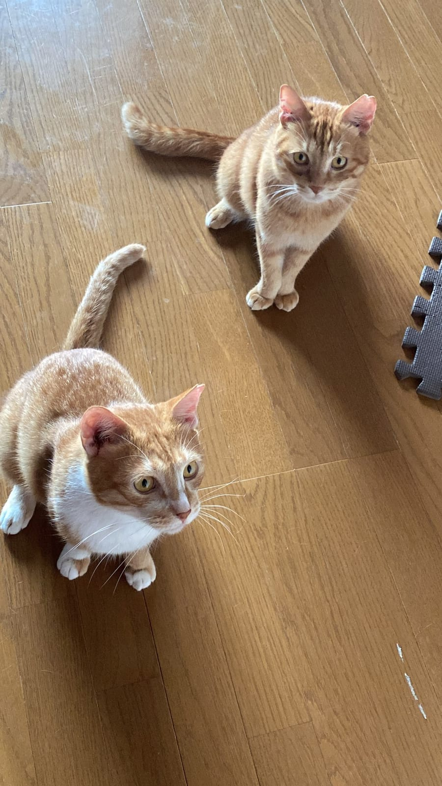
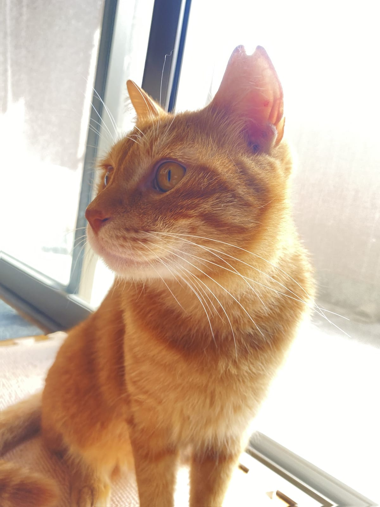

猫の1歳は、人でいえば15〜17歳。中学3年生から高校生くらいです。そこから先は1年で人の4年ぶんずつ年を重ねていきます。換算表の読み方と、年齢ごとに健康診断をどのくらいの間隔で受ければいいのか。獣医師の団体がまとめた資料をもとに整理しました。

## 1歳で15歳、7歳で44歳。猫の年齢はこう進む

環境省が2013年に出したパンフレットには、猫と小・中型犬の年齢を人に置きかえた表が載っています。それによると、1歳で15歳、2歳で24歳。3歳からは1年ごとに4歳ずつ足していき、7歳で44歳、10歳で56歳、15歳で76歳になります。

最初の2年で一気に大人になり、あとは一定のペースで進む、という形です。岐阜大学の獣医師が監修した富士フイルムの解説ページにも参考の換算表がありますが、こちらは1歳を17歳、2歳を23歳としています。3歳以降の数字はほぼ同じで、20歳は96歳。表によって最初の数年に少し差があるので、「だいたいの目安」として読むのがよさそうです。環境省のパンフレットでも、品種や暮らし方によって違ってくると断りが入っていました。

## 獣医師の団体が分けた4つのライフステージ

では、何歳から「シニア」なのか。米国の猫専門の獣医師団体AAFPと米国動物病院協会（AAHA）が2021年にまとめたガイドラインでは、猫の一生を年齢で4つに分けています。

- 子猫期　生まれてから1歳まで
- 若年成猫期　1歳から6歳
- 中年期（成熟成猫期）　7歳から10歳
- シニア期　10歳から

これとは別に、年齢に関係なく訪れる「終末期」も1つの段階として扱われています。人の年齢にあてはめると、7歳はおよそ44歳、10歳は56歳。7歳が体の変化に気を配り始める区切りになっている点は、環境省のパンフレットとも重なります。

一方、福岡市獣医師会の資料では、シニアにはっきりした定義はないとしたうえで、一般に6〜8歳ごろからと説明されていました。犬と猫の平均寿命は12〜15歳ほど、とも書かれています。

*手前の胸が白いほうがムギ、奥がテン。同じ茶トラでも見分けはつきます。*

## 健康診断は1歳から年1回、シニアは半年に1回

健康診断の回数について、富士フイルムの解説では1歳を過ぎたら年に1回、7歳以上のシニア期に入ったら年に2回を目安にしています。福岡市獣医師会の資料も、8歳を過ぎたら定期的な健康診断を受けるようすすめていました。

AAFPが2009年にまとめたシニアケアのガイドラインは、もう少し踏みこんでいます。元気そうに見えるシニア猫でも6か月ごとに診察を受けること。シニア期以降は血圧を少なくとも年に1回測ること。血液や尿の検査は7〜10歳ごろから、少なくとも年1回は考えること。年をとるほど、診察の間隔は短くしていく考え方です。

半年に1回と聞くと多く感じるかもしれません。ただ、猫の半年は人の2年ぶんにあたります。人が2年に1回しか健診を受けないと考えると、間隔の感じ方が少し変わってきます。

## 「年のせい」で片づけないための家でのチェック

同じAAFPのガイドラインには、猫は病気があっても元気そうにふるまい、体がもちこたえられなくなるまで隠してしまうことがある、と書かれています。関節の痛みによる動きの変化が「もう年だから」と見すごされやすい、という指摘もありました。

福岡市獣医師会の資料に挙がっている変化のうち、家で気づきやすいものを並べると次のようになります。

- 体重が減ってきた（糖尿病、腎臓の病気、甲状腺の病気などのサインのことがある）
- 水をよく飲み、おしっこが増えた（ふだんの飲水量は体重1kgあたり1日40〜50mlほど）
- 高いところに跳び乗らなくなった、歩き方がおかしい

この資料では、年のせいだと思っていた変化が、治療できる病気から来ていることもあるとしています。おかしいと感じたら、自分で判断せずにかかりつけの動物病院に相談してほしい、というのが獣医師会からのメッセージでした。

ねこの惑星からの提案としては、月に1回、同じ体重計で体重を量ってメモしておくことです。AAFPのガイドラインでも、体重の変化を記録して比べることがすすめられていました。数字が残っていれば、健康診断のときに獣医師へ「いつから減ったか」を伝えられます。

*窓辺のテン。いつもの場所にいつも通り来るかどうかも、立派な観察です。*

## まずは「うちの子が人間で何歳か」を確かめる

ねこの惑星では、2022年の春ごろからテンとムギの写真を撮りためてきました。箱を見つけると2匹そろって収まりにいくのは、今も昔も同じです。こうした写真や動画は、あとから見返すと「いつごろから動きが変わったか」を確かめる手がかりにもなります。

保護猫を迎えるときは、正確な誕生日がわからないこともあります。そんなときは、迎えた日に動物病院でおおよその年齢を聞いておき、上の換算表で人の年齢に置きかえてみてください。7歳に近づいていたら、健康診断を年2回にする準備を始める合図です。
