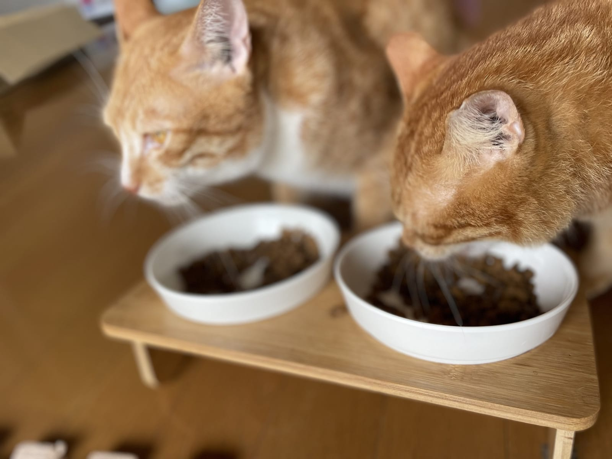
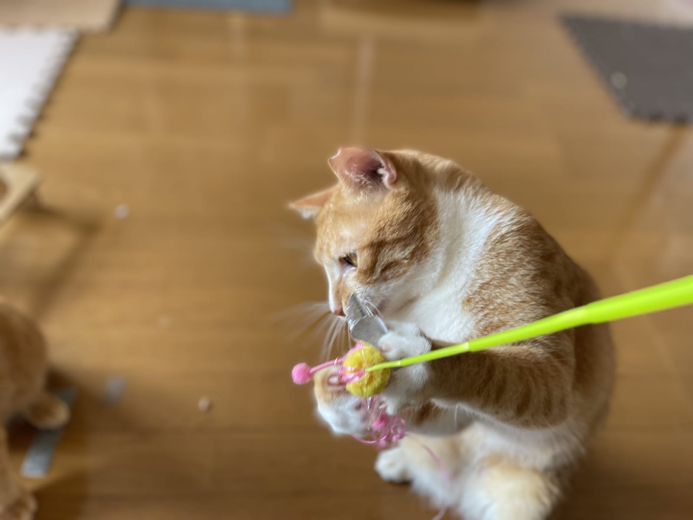

日本の「猫の日」が2月22日なのは、猫の鳴き声の語呂合わせから。では、それを決めたのは誰で、いつだったのか。夏の8月8日にある「世界猫の日」はどこから来たのか。アメリカやロシア、イタリアにもそれぞれ別の日付の猫の日があります。調べてみると、国ごとの「猫の見え方」がちょっとずつ違っていて面白い話でした。

## 2月22日は、愛猫家の公募で決まった日

日本の猫の日が生まれたのは1987年（昭和62年）。ペット保険のアニコムが2007年に出した資料によると、ペットフード工業会が主催する「猫の日制定委員会」が、全国の愛猫家から公募して決めたものだそうです。2月22日を「ニャン・ニャン・ニャン」と読む、あの語呂合わせが選ばれた理由でした。

もう少し補足すると、IT・家電の情報サイトBCN＋Rの記事では、ペットフード協会と愛猫家たちの「猫の日実行委員会」の働きかけで誕生した、と紹介されています。団体や委員会の呼び名は資料によって少し違いますが、「1987年」「ペットフードの業界団体と愛猫家が関わった」「222が鳴き声に聞こえるから」という3点はどちらの資料でも一致していました。

この語呂合わせは、実は日本語ならではのもの。同じBCN＋Rの記事によれば、海外では猫の声を「ミャウ」「ミュー」のように書き表すのが一般的で、数字の2を「に」と読むのも日本だけ。英語圏の人に「222はニャーニャーニャーなんだよ」と説明しても、たぶんすぐには通じません。

今では毎年2月22日になると、各地で猫にちなんだキャンペーンやイベントが開かれるようになりました。

## 8月8日の世界猫の日は、動物福祉団体が始めた

夏にあるもう一つの猫の日が、8月8日の「世界猫の日（International Cat Day）」。イギリスの新聞The Scotsmanによると、始めたのは国際動物福祉基金（IFAW）という大きな動物福祉・保護団体で、2002年のことでした。

目的は、猫への関心を高めること。飼い猫だけでなく、ライオンやトラのような野生の大型ネコ科動物も含めて、どう守り、どう助けるかを知ってもらう日として紹介されています。

2020年からは、運営の担い手がイギリスの非営利団体インターナショナル・キャット・ケア（iCatCare）に移りました。1958年から飼い猫の健康と福祉に取り組んできた団体です。獣医看護師向けのニュースサイトVNonlineの記事では、2025年のテーマは「キャット・フレンドリー（猫にやさしい）」とはどういうことか、でした。猫それぞれの性格を尊重し、暮らす環境や他者との関わり方の希望に応えること。そして、毎日の小さな工夫を積み重ねてもらうことが呼びかけられています。

ちなみに、なぜ8月8日なのかという理由は、今回あたった資料には書かれていませんでした。日本の2月22日のような語呂合わせがあるわけではなさそうです。

*記念日でもそうでなくても、ごはんは2匹そろって。*

## アメリカは10月、ロシアは3月、イタリアは2月17日

世界猫の日とは別に、自分たちの「猫の日」を持つ国もあります。The Scotsmanの記事で挙げられていたのは次の2つ。

- アメリカ……10月29日がナショナル・キャット・デー。8月8日の世界猫の日と両方を祝う
- ロシア……3月1日が国の猫の日

由来がいちばん凝っているのはイタリアかもしれません。イタリアの全国紙Il Fatto Quotidianoによると、イタリアの猫の日（Festa del gatto）は2月17日。1990年、猫雑誌『Tuttogatto』の記者クラウディア・アンジェレッティさんが読者投票を呼びかけて決まったといいます。

選ばれた理由として、記事はいくつかの説を挙げていました。2月は自由で型にはまらない人が多いとされる水瓶座の月で、猫の気質に重なる。17はイタリアでは縁起の悪い数字で、かつて黒猫が背負わされたイメージと同じ。さらに、ローマ数字で17を表す「XVII」を並べ替えると、ラテン語の「VIXI（私は生きた）」になる。イタリアでは猫の命は7つあると言われるので、そこにもかけているのだとか。記事自体がこれらを冗談まじりに紹介しているので、どこまで本気の理由なのかは定かではありません。

日本は鳴き声、イタリアは数字の言い伝え。同じ「猫の日」でも、決め方にその国の文化がにじんでいます。

## ねこの惑星の猫の日

ねこの惑星で暮らすテンとムギは、茶トラのオスの兄弟です。ほぼ全身オレンジなのがテン、胸と口元が白くて鼻がピンクなのがムギ。猫の日だからといって特別なことをするわけではなく、2匹は今日も箱を見つけたら入らずにはいられません。

*新しいおもちゃを前にすると、ムギはこうなります。*

記念日をどう過ごすかは自由ですが、ねこの惑星からの提案を2つ。

- 2月22日と8月8日を、年に2回の「写真を撮る日」にする。同じ場所・同じ角度で撮っておくと、体つきや毛づやの変化があとで見比べやすい
- どちらかの日を、ワクチンや健康診断の予定を確かめる日にする

とくに2つめは、カレンダーに書きこんでおくだけで忘れにくくなります。体重の増減や食欲の変化など、写真を見比べて気になることがあれば、かかりつけの動物病院に相談してみてください。

次の猫の日は2027年2月22日。テンとムギにも、その日は新しい箱を1つ用意してみようと思います。
