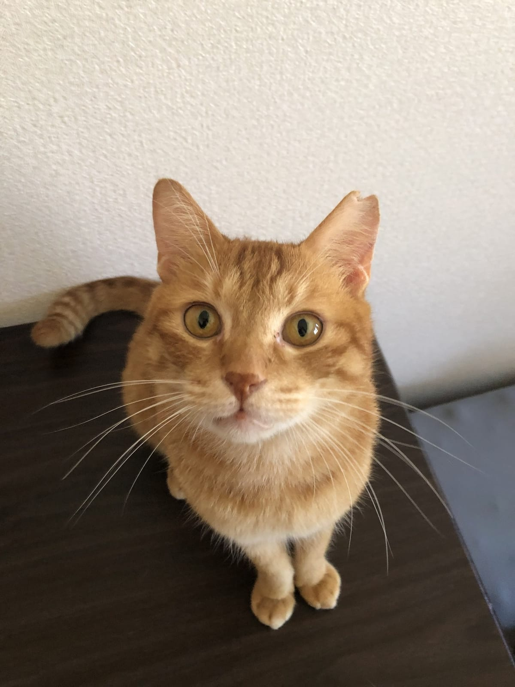

猫と暮らす人のオキシトシンと、その家の猫のオキシトシン。この2つに関連があったという研究が、10月に京都大学と麻布大学から発表されました。犬では飼い主と犬のホルモン濃度の関連が報告されていましたが、猫で飼い主とのオキシトシンの関連を示したのは初めてだそうです。どんな調べ方をして、どこまで言えるのか。最後に、ねこの惑星のテンの様子もまじえて考えます。

## どんな研究？ 飼い主19人と猫29匹を1か月追いかけた

研究したのは、京都大学白眉センターの高木佐保特定助教と、麻布大学獣医学部の菊水健史教授らのグループです。論文は米国の学術誌『iScience』に、2026年10月14日（米国東部時間）付で掲載されました。

参加したのは、猫と暮らす飼い主19人と、その家の猫29匹。飼い主は18〜60歳で、女性16人、男性3人という内訳です。猫は生後4か月から13歳まで幅があります。このうち尿を採れた猫は24匹で、ホルモンの分析は24組で行われました。

調べ方は、家での1か月間の暮らしをそのまま記録するものでした。飼い主と猫の尿をそれぞれ3回ずつ採り、オキシトシンとコルチゾールの濃度を測定。オキシトシンは人や動物どうしの結びつきに関わるホルモンで、「愛情ホルモン」と呼ばれることもあります。コルチゾールはストレスに関わるホルモンです。

おもしろいのは「距離」の測り方。猫の首輪に小さなBLEビーコン（電波を出す発信機）を付け、飼い主のスマートフォンで電波の強さを1か月記録し続けたそうです。電波が強ければ近くにいる、という理屈で、家の中で猫と人がどれくらい近くにいたかを推定しています。飼い主の気分は、POMS2という気分を測る質問票（日本語版の短縮版）で調べました。

## わかったこと① 飼い主と猫のオキシトシンがそろって高い

結果を、ホルモン同士の関係から順に並べます。

- 飼い主のオキシトシンが高いほど、猫のオキシトシンも高い傾向
- 飼い主のコルチゾールが高いほど、猫のオキシトシンは低い傾向
- 猫と飼い主のコルチゾール同士には、はっきりした関連なし

研究チームは、猫と人の生理的なつながりは、ストレスのホルモンよりもオキシトシンが中心になっている可能性を示しています。

もう1つ目を引くのが、猫のオキシトシンと飼い主の気分の関係でした。猫のオキシトシンが高い家ほど、飼い主の「怒り」「混乱」「落ち込み」「緊張」といったネガティブな気分が低い傾向が出ています。しかも、飼い主自身のオキシトシンより、猫のオキシトシンのほうが飼い主のネガティブな気分をよく予測していたといいます。高木さんは、猫が膝に乗って甘えてくるときのような触れ合いで心が安らぐ感覚の一端が、オキシトシンを介した関連として見えてきたのかもしれない、とコメントしています。

## わかったこと② 猫と近くで過ごす人ほど「活気」が高い

ビーコンのデータからは、家の中で猫の近くにいる時間が長い飼い主ほど、気分の「活気」が高い傾向が出ました。一方で、猫と暮らしている年数の長さと活気には関連が見られなかったそうです。長く一緒にいるかより、ふだんどれだけ近くで過ごすか。そう読める結果でした。

猫の側の行動も観察されています。床に描いた円の中に飼い主か見知らぬ人が座り、猫が円に入るか、どのくらいとどまるかを見るテストでは、オキシトシンが高い猫ほど、相手が飼い主でも知らない人でも近づきやすい傾向がありました。

## まだわからないことは？ 「猫がいると元気になる」とは言い切れない

ここは大事な注意点です。今回わかったのは「関連」で、どちらが原因かは不明だと研究者自身が述べています。猫のオキシトシンが高いから飼い主が穏やかなのか、穏やかな飼い主のそばだから猫のオキシトシンが高いのか、まだ区別できません。

ほかにも限界がはっきり書かれています。事前登録をしていない探索的な研究であること。参加者が少なく、女性が多いこと。ある一時点での関連を見たもので、時間を追った変化までは調べていないこと。そして同じ家で暮らす以上、生活リズムや住まいの環境といった共通の要因が両方に影響している可能性もあります。チームは今後、もっと幅広い人を対象に、同じタイミングで繰り返しデータを取る研究や実験的な研究を進める予定とのことです。

なので「猫を飼えば気分が良くなる」と読むのは早すぎます。気分の落ち込みが続くときは、猫に頼るのではなく、医療機関や身近な人に相談してください。

## うちの猫だとどうなの？ テンの「近さ」から考える

*机の上から、まっすぐこちらを見上げる1枚。*

ねこの惑星のテンは、カメラを向けると自分から顔を近づけてきます。表紙の写真も、顔がすぐ目の前まで来たときの1枚です。研究の「近さ」の視点で見ると、テンはカメラを向けた人のそばに自分から来る猫です。ただし、テンのオキシトシンを測ったわけではないので、この研究の結果がそのまま当てはまるとは言えません。

研究が効果を示したわけではありません。それでも気になる人は、猫との距離感を少し意識してみてはどうでしょう。猫がそばに来たら追い払わずにそのままにして、来ないときは無理に抱き上げない。かまう時間より、近くにいる時間。今日から変えられるのは、そのくらいの小さなことです。

テンは今日も、カメラを構えた人のほうへ寄ってきます。
