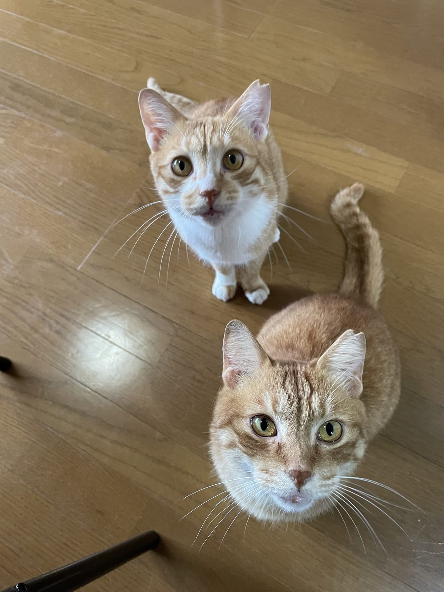

猫と目が合ったとき、相手がすうっと目を細めて、ゆっくりまぶたを閉じる。猫好きのあいだで「猫の笑顔」とも呼ばれてきたこのしぐさを、イギリスの研究チームが実験で確かめました。人がまねると猫は返してくれるのか。初対面の猫との距離は縮まるのか。研究の結果と、家や譲渡会ですぐ試せるやり方を順に書いていきます。

## 「ゆっくりまばたき」とはどんな動きか

研究を行ったのは、英サセックス大学とポーツマス大学の心理学者たちです。2020年に科学誌『Scientific Reports』に論文が載りました。

論文では、このしぐさを「スローブリンク」と呼んでいます。中身は、まぶたが閉じきらない半分だけのまばたきを何度かくり返し、そのあと目を細めたままにするか、完全に閉じる、という一続きの動き。目を閉じずにまぶたを下げたままにする状態も「目を細める」として細かく記録しています。これまでは、猫が落ち着いていて機嫌のいいときに見られる、という経験談が中心でした。

人の笑顔との共通点にも、論文は触れています。心から笑うと人は目のまわりが細くなりますが、イヌ科の動物が遊ぶときの顔や、なでられている馬や牛の顔にも、同じように目を細める動きが見られるそうです。

## 飼い主がまねると、猫も目を細めて返した

実験は2つあります。1つ目は、14世帯で暮らす21匹の猫と、その飼い主の組み合わせ。猫が落ち着いたところで、飼い主が1mほど離れて座り、猫に向かってゆっくりまばたきをしました。比べたのは、飼い主が同じ部屋にいるだけで何もしない場合です。

結果、飼い主がゆっくりまばたきをしたときのほうが、猫は目を細めたり、半分のまばたきをしたりする回数が多くなりました。一方で、ふつうの反射的なまばたきの回数には差がなかったとのことでした。

2つ目の実験では、猫が初めて会う研究者が相手です。研究者はゆっくりまばたきをするか、目を合わせない無表情のままでいるか、どちらかをしたあと、手のひらを上にして猫のほうへ差し出しました。すると、ゆっくりまばたきのあとのほうが、猫はまばたきを返しやすく、差し出された手に近づきやすかったそうです。

## なぜ猫はじっと見つめられるのが苦手なのか

研究チームは、このまばたきの起源を、相手をじっと見つめ続ける状態を「切る」ためのものだったのでは、と考えています。社会的な場面では、まっすぐ見つめ続けることが脅しと受け取られる場合がある、というのがその理由。実際、2つ目の実験で無表情の比較条件に目を合わせない顔を選んだのも、予備実験で、猫が正面からの視線を怖がるように見えたからだと書かれています。

もう1つの見方は、学習です。人は猫のゆっくりまばたきを好意的に受け取るので、猫は「これに応えるといいことがある」と覚えてきたのかもしれない。サセックス大学の発表で、筆頭著者のタスミン・ハンフリーさんがそう話しています。

*ムギとテン、そろって見上げてくると目力が強い。*

ただし、論文の著者たちは慎重です。ゆっくりまばたきはうれしい気持ちのサインに見えるものの、猫がどんな気持ちなのかを言い切るには、さらに研究が必要だと書いています。猫は飼い主の表情には反応しても初対面の人には反応しなかった、という別グループの研究とは結果が食い違っていて、その点も論文に書かれています。「猫の笑顔」は、いまのところ有力な仮説、くらいに受け止めておくのがよさそうです。

## 初めて会う猫には「まばたき」と「待つ」で近づく

まばたきのやり方は、サセックス大学の発表がわかりやすく説明しています。くつろいでほほえむときのように目を細め、そのまま数秒、目を閉じる。猫の目をじっと見続けないのがコツです。

オーストラリアの動物保護団体RSPCA NSWは、猫にさわる前に「猫に選ばせる」ことをすすめています。猫のほうから近づいてきたら手を差し出して待つ。においをかぐだけなら、まださわってよいという合図ではありません。手に顔や体をこすりつけてきたら、なでてかまわないそうです。研究の2つ目の実験で、研究者が手を差し出して猫が来るのを待ったのと同じ流れになっています。

同じ団体の記事をもとに、なでるときの目安を並べると次のようになります。

- 最初になでるのは、ほお、あごの下、おでこ、耳のうしろ
- 顔をそむける、耳を伏せる、しっぽをパタパタ振るときは手を止める
- 長くなでるより、短く切り上げて、猫に続けるかどうかを選んでもらう

RSPCA NSWの記事では、ゆっくりまばたきも、安心しているときのサインの1つに挙げられています。反対に、いつもは喜んでいた場所をさわられて急に嫌がるようになったときは、痛みが隠れていることもあるそうです。そういうときは動物病院で診てもらってください。

## 今日、猫と目が合ったら

ねこの惑星のテンは、カメラを向けると顔をぐっと近づけてきます。ムギは目がくりっと大きい猫です。2匹と目が合ったときも、じっと見つめ返すより、目を細めてゆっくり閉じるほうが猫にとっては穏やかなあいさつになるはず、というのがねこの惑星の考えです。

家の猫と目が合ったら、数秒だけ目を閉じてみてください。返事が来るかどうかは、猫の気分しだい。来なくても、にらめっこを先に降りる合図にはなります。
