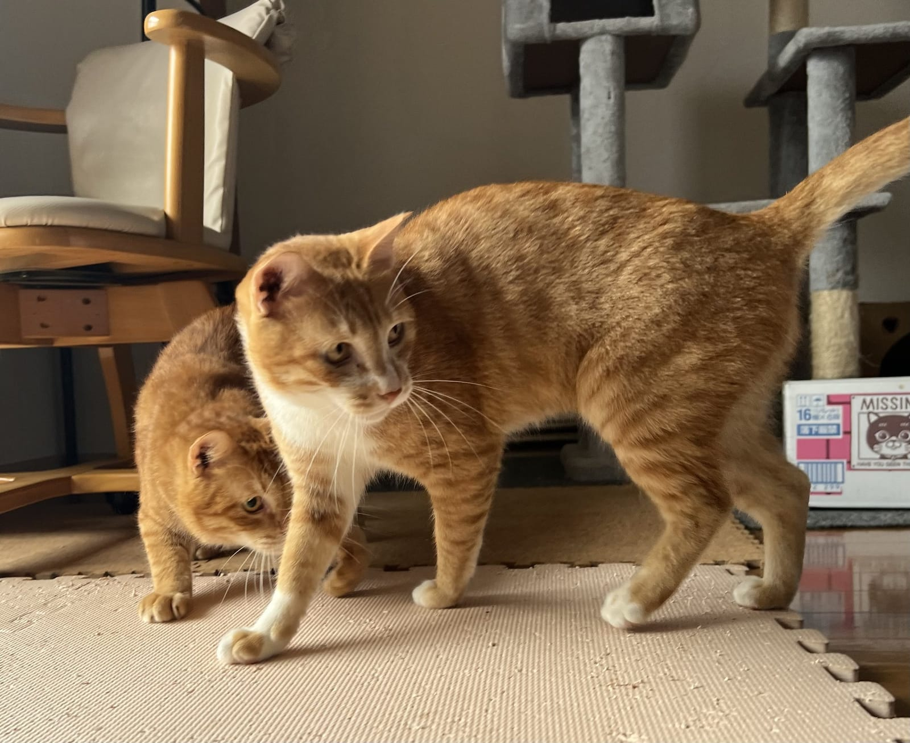
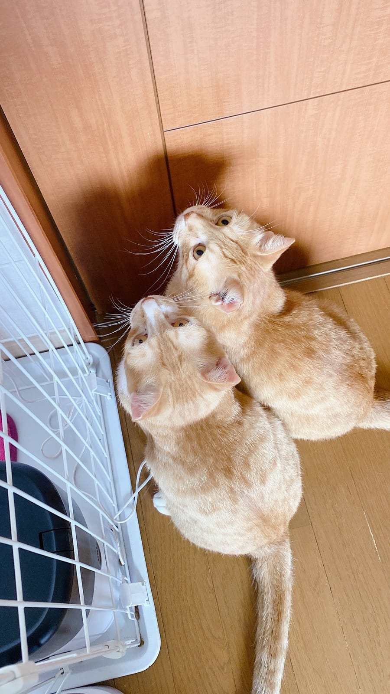

先住猫がいる家に、新しい猫を迎える。そのとき最初の顔合わせをどう進めるかで、迷う人は多いはずです。部屋を分けてじっくり慣らすのが定番とされていますが、デンマークの調査では、半分以上の飼い主が初日から一緒にしていました。この記事を読むと、調査で見えた実際のやり方、獣医師向けの指針がすすめる準備、そして「様子見」をどこで判断するかがわかります。

## 半分以上の家は、初日から一緒にしていた

調べたのはコペンハーゲン大学などの研究チームです。デンマークで猫を飼う1,507人にアンケートを行い、そのうち先住猫のいる家に新しい猫を迎えた経験のある308人の回答を詳しく分析しました。論文は2025年に学術誌『Applied Animal Behaviour Science』に載っています。

チームは、部屋を分ける、柵越しに会わせる、においを交換する、お互いの場所を探検させる、フェロモン製品を使うなど、16の慣らし方について、使ったかどうかを聞きました。あわせて、最初の1か月に2匹がどう反応したかも尋ねています。

いちばん多かったのは、最初から2匹を一緒にするやり方でした。回答者の56%がこれにあたります。

結果で目を引くのは、猫の年齢で傾向が逆になったことです。2匹とも4歳未満の若い組み合わせでは、部屋を分ける、柵を使う、においを交換するといった「定番の慣らし方」を使った家で、最初の1か月にけんか腰の反応が出やすいという関連が見られました。反対に、2匹とも5歳以上の組み合わせでは、柵を使う、同じ部屋で遊ぶ、猫が使うもの（資源）を増やすといったやり方が、仲のよい関係と結びついていたそうです。

## 「慣らし方が逆効果」と読むのは早い

若い猫で慣らし方とけんかが結びついていた、と聞くと「隔離しないほうがいいのか」と思いたくなります。ただ、研究チーム自身がその読み方に慎重です。関連はどれも強くなかったこと、そして飼い主が、すでにけんかが起きたあとで慣らし方を始めたり、うまくいかなそうだと予想して使ったりした可能性があることを挙げています。つまり「慣らしたからけんかした」のか「けんかしそうだから慣らした」のかは、この調査では区別できません。

一方で、獣医師向けの指針は、段階を踏む顔合わせをすすめています。米国の猫専門の獣医師団体、AAFP（American Association of Feline Practitioners）が2024年に出した猫どうしの緊張についてのガイドラインです。そこで紹介されている調査では、複数の猫を飼う2,492世帯のうち87.7%が猫どうしの緊張のサインを報告し、回答者の73.3%が「新しい猫が来たときから始まった」と答えていました（2020年に発表された調査）。迎え方に気を配りたくなる理由の一つです。

この指針は、新しい猫にはまず専用の部屋を用意し、においの交換やドア越しの遊びから少しずつ距離を縮める手順を示しています。途中で緊張が見えたら一つ前の段階に戻ること、そしてすっかりなじむまで何週間、場合によっては何か月もかかるつもりでいるよう書かれています。

## 迎える前に、部屋の中を「取り合わない」形にする

どちらのやり方を選ぶにしても、部屋の準備はやっておいて損がありません。AAFPの指針で具体的なのは次のあたりです。

- 隠れられる安全な場所は「猫の数＋1か所」
- ごはんは、同じグループの仲よし同士でも、お互いが見えない別々の場所で
- ごはんは水やトイレから離し、トイレと爪とぎは部屋の隅寄りの別々の場所に、階ごとに置く
- 出入り口が2つある隠れ場所にすると、片方の猫がもう片方を閉じこめにくい

指針は、猫どうしの緊張は「順位を決めるため」に起きるという考えには根拠がない、とも書いています。にらみ合いや追いかけっこは、ボス争いとして見守るより、資源の取り合いや居心地の悪さのサインかもしれない、と考えるほうがよさそうです。逆に、取っ組み合いに見えても、声を出さず交代で追いかけ合っているなら遊びのことも多く、指針でも、激しく見えても遊びのことがあると注意しています。片方がいつも追い、片方がいつも隠れるなら、遊びではないかもしれません。

*この日は、ムギが前でテンがうしろ。*

## 兄弟のテンとムギでも、器や寝床は分けたい

ねこの惑星のテンとムギは、茶トラの兄弟です。箱を見つけると、2匹そろって収まっていることもあります。AAFPの指針は、大人の猫を2匹迎えるなら、すでに仲のよい猫や血縁のある猫を選ぶとよいとしています。血縁のある猫どうしは仲が続きやすく、緊張も起きにくいという理由です。

ただ、兄弟だからといって、何もしなくてよいわけではありません。2匹がそろっていても、ごはんの器、水、トイレ、休む場所は複数あったほうが、どちらかが我慢する場面を減らせます。

## 迎えてからの数週間は、様子を書きとめる

デンマークの調査が最初の1か月の反応を聞いたように、迎えてからしばらくは、2匹の様子を記録しておくと判断がしやすくなります。シャーッと威嚇する、にらむ、片方が物陰から出てこない。こうした様子が続くなら、部屋や柵で分けて段階を踏むやり方に切り替えるか、ごはんや隠れ場所を増やすところから見直します。慣れるまで何か月もかかることもあるので、焦らなくて大丈夫です。食欲が落ちる、トイレ以外で排せつするなど体の変化が出たときは、けんかのせいと決めつけず、動物病院に相談してください。

これから2匹目を迎える予定があるなら、まずは家の見取り図を描いてみてください。隠れ場所を「猫の数＋1」か所置けるか、ごはんをお互いが見えない場所に分けられるか。紙の上で確かめておくと、迎えた日に慌てずにすみます。テンとムギなら、まず箱が1つあれば2匹で入っていそうですが。
